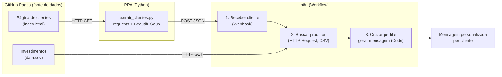
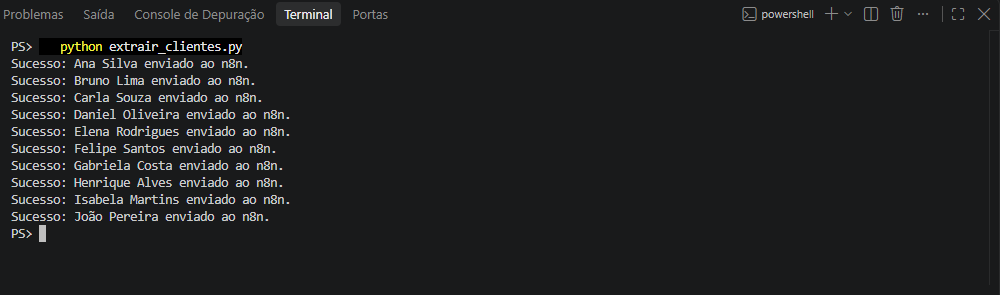
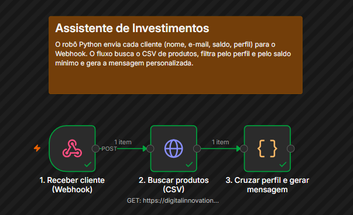
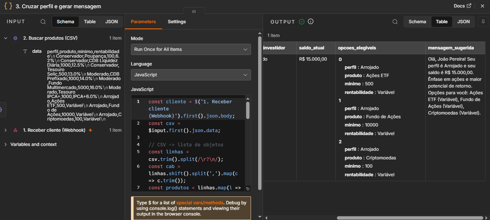

# Assistente de Investimentos com RPA (Python) e n8n

Solução do desafio de projeto da DIO **"Criando um Assistente de Investimentos com RPA e IA Generativa"**.

Um robô em Python (RPA) extrai clientes de uma página web e envia cada um para um workflow no **n8n**, que cruza o perfil do investidor com uma base de produtos de investimento (CSV) e gera uma mensagem personalizada.

> **Escopo entregue: MVP** — mensagens geradas por templates fixos, sem IA generativa e sem envio real de e-mails (veja [Limitações](#limitações)).

---

## Objetivo

Construir um pipeline de automação que:

1. **Coleta** os dados dos clientes de uma página web simulada com Python;
2. **Processa** cada cliente em um workflow no n8n, acionado por Webhook;
3. **Cruza** o perfil e o saldo do cliente com a base de investimentos (`data.csv`);
4. **Gera** uma mensagem personalizada por cliente.

> **Por que isso é RPA?** O script faz o que uma pessoa faria manualmente: abrir uma página, ler uma tabela e digitar os dados em outro sistema. Aqui o "robô" executa isso automaticamente, útil quando não existe API disponível.

---

## Arquitetura



### Etapas

| Etapa | Ferramenta | Função |
|---|---|---|
| Fonte de dados | GitHub Pages | Serve a página de clientes e o CSV de investimentos |
| Extração (RPA) | Python + `requests` + BeautifulSoup | Lê a tabela HTML e envia cada cliente em JSON via `POST` |
| Orquestração | n8n | Recebe o cliente, busca o CSV, cruza os dados e monta a mensagem |

---

## Estrutura do repositório

```
desafio-dio-rpa-n8n/
├── README.md
├── requirements.txt
├── rpa/
│   └── extrair_clientes.py      # robô de extração e envio ao Webhook
├── n8n/
│   └── workflow.json            # workflow exportado do n8n
└── docs/
    └── img/                     # prints da execução
```

---

## Nós do workflow

### `1. Receber cliente (Webhook)` (gatilho)
Recebe `POST /investimentos` com o JSON de um cliente: `nome`, `email`, `saldo` e `perfil`. Os dados chegam no campo `body` da requisição.

### `2. Buscar produtos (CSV)` (HTTP Request)
Faz `GET` no `data.csv` hospedado no GitHub Pages. O conteúdo chega como texto no campo `data`.

### `3. Cruzar perfil e gerar mensagem` (Code, JavaScript)
- Converte o CSV em uma lista de objetos;
- Converte o saldo (`"R$ 10.000"`) em número;
- Filtra os produtos do **mesmo perfil** do cliente cujo **valor mínimo** seja menor ou igual ao saldo;
- Escolhe o texto-base pelo perfil (Conservador, Moderado ou Arrojado);
- Retorna `nome_cliente`, `email`, `perfil_investidor`, `saldo_atual`, `opcoes_elegiveis` e `mensagem_sugerida`.

> O canvas também tem uma *Sticky Note* (`Nota explicativa`) que resume o fluxo; ela é apenas documentação visual e não executa nada.

### Templates por perfil (MVP)

| Perfil | Foco da mensagem |
|---|---|
| Conservador | Renda fixa e segurança |
| Moderado | Mix equilibrado entre renda fixa e variável |
| Arrojado | Ações e maior potencial de retorno |

---

## Como executar

### Requisitos
- Python 3.10 ou superior;
- n8n (local ou n8n Cloud);
- Acesso à internet (a página de clientes e o CSV ficam no GitHub Pages).

### Passo a passo

1. **Clone o repositório e instale as dependências**
   ```bash
   git clone https://github.com/Infantozzi01/desafio-dio-rpa-n8n.git
   cd desafio-dio-rpa-n8n
   pip install -r requirements.txt
   ```

2. **Importe o workflow no n8n**: *Workflows → Import from File* e selecione `n8n/workflow.json`.

3. **Ative (publique) o workflow**: salve e use o botão **Publish/Active** no topo do editor. Só com o workflow ativo a URL de produção (`/webhook/`) passa a responder.

4. **Confira a URL do Webhook** no arquivo `rpa/extrair_clientes.py`:
   ```python
   WEBHOOK_URL = "http://localhost:5678/webhook/investimentos"
   ```
   Se usar n8n Cloud, troque pela URL de produção exibida no nó Webhook.

5. **Execute o robô**:
   ```bash
   python rpa/extrair_clientes.py
   ```
   Cada cliente é enviado em uma requisição e dispara uma execução do workflow.

   > **Modo de teste (opcional):** com a URL `/webhook-test/investimentos` é preciso clicar em **Execute workflow** antes de cada envio, pois a URL de teste atende uma única requisição por vez.

6. **Confira o resultado** na aba **Executions** do n8n: abra uma execução e clique no nó `3. Cruzar perfil e gerar mensagem` para ver a mensagem gerada.

---

## Evidência de funcionamento


| Execução do script | Workflow no n8n | Saída final |
|---|---|---|
|  |  |  |

---

## Diagnóstico de problemas comuns

| Sintoma | Causa provável e ação |
|---|---|
| HTTP 404 `webhook ... is not registered` | Na URL de produção, o workflow não está ativo: publique-o. Na URL de teste, clique em **Execute workflow** antes de cada envio. |
| Script avisa falha com status diferente de 200 | Confira a URL do Webhook, o caminho `investimentos` e o método `POST`. |
| Todos os clientes recebem a mesma recomendação | O código do nó Code deve ler os dados de `body` do Webhook. |
| `opcoes_elegiveis` vazio | Confira a URL do CSV, o cabeçalho do arquivo e se o saldo atinge o mínimo dos produtos do perfil. |
| `ModuleNotFoundError: requests` ou `bs4` | Rode `pip install -r requirements.txt` no mesmo Python usado para executar o script. |
| Erro de conexão com `localhost:5678` | O n8n não está rodando. Se ele estiver em Docker, confira o mapeamento da porta 5678. |

---

## Limitações

- Usa **dados fictícios**; não executa operações financeiras e não valida *suitability* regulatória;
- As mensagens vêm de **templates fixos**; a seleção de produtos depende apenas de **perfil e saldo mínimo**;
- **Não usa IA generativa** e **não envia e-mails**: o resultado é um JSON pronto para ser encaminhado por Gmail, Slack ou por um Agente de IA em uma evolução futura;
- A URL de teste do Webhook é temporária e atende uma requisição por vez; por isso o projeto usa a URL de produção, com o workflow ativo.

---

## Próximos passos (evolução)

- Adicionar um **Agente de IA** (Gemini ou GPT) no n8n para gerar mensagens únicas por cliente (desafio completo);
- Incluir validação do formato de e-mail e envio via **Gmail**;
- Retornar uma resposta ao script com o **Respond to Webhook**.

---

## Tecnologias

Python · `requests` · BeautifulSoup · n8n · JavaScript (nó Code) · GitHub Pages

## Autor

[@Infantozzi01](https://github.com/Infantozzi01)

Projeto desenvolvido no bootcamp da [DIO](https://www.dio.me/). Repositório base: [digitalinnovationone/dio-lab-assistente-investimentos-rpa-n8n](https://github.com/digitalinnovationone/dio-lab-assistente-investimentos-rpa-n8n).
